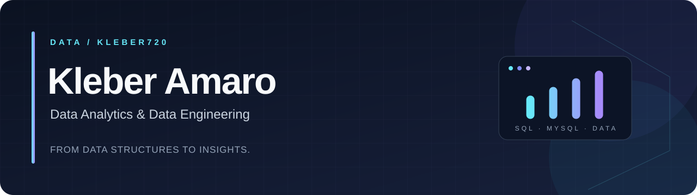

[← Início](https://github.com/Kleber720) · [Desenvolvedor](https://github.com/Kleber720/Kleber720/blob/main/DESENVOLVEDOR.md) · [Dados](https://github.com/Kleber720/Kleber720/blob/main/DADOS.md)

# Análise de Dados & Engenharia de Dados

**SQL para responder perguntas de negócio. Modelagem para estruturar a base da análise.**

**Busco oportunidades em Análise de Dados e Engenharia de Dados.**

[Análise de Dados](#análise-de-dados) · [Engenharia de Dados](#fundamentos-de-engenharia-de-dados) · [Projetos](#projetos-em-destaque) · [Stack](#stack-e-evidências)

## Perfil profissional

Sou **Kleber Amaro**, técnico em TI formado pelo **Senac Santana** e estudante de **Game Design na Anhembi Morumbi**. Direciono minha carreira para dados, com projetos em **SQL, MySQL, modelagem relacional e construção de indicadores**, além de prática com **Python e persistência em JSON**.

Meu portfólio conecta duas etapas do trabalho com dados: **organizar informações em uma estrutura consistente** e **escrever consultas que ajudem a interpretar resultados**. Os projetos aplicam essa base em análise esportiva e gestão de equipamentos corporativos.

## Análise de Dados

**Traduzir perguntas em consultas e indicadores verificáveis.**

- **Exploração com SQL:** relacionar registros, selecionar informações relevantes e ordenar resultados com JOINs, filtros e ordenações.
- **Indicadores de desempenho:** calcular participações em gols, saldo de gols e aproveitamento de pontos.
- **Relatórios operacionais:** consultar disponibilidade de equipamentos e consolidar quantidades por setor com COUNT, SUM e GROUP BY.
- **Consultas reutilizáveis:** organizar regras de cálculo em views, com fórmulas disponíveis para revisão.

**Projeto para começar:** [Corinthians Data Analytics](https://github.com/Kleber720/bancodeDadosCOR) — da pergunta sobre desempenho à consulta SQL.

## Fundamentos de Engenharia de Dados

**Estruturar a base que sustenta consultas e aplicações.**

- **Modelagem relacional:** separar entidades e definir relacionamentos entre jogadores e estatísticas ou entre setores, funcionários e equipamentos.
- **Integridade dos dados:** usar chaves primárias, chaves estrangeiras e restrições NOT NULL e UNIQUE conforme o modelo.
- **Organização da carga:** separar criação do schema, inserção de registros e definição de views em scripts SQL.
- **Operações no banco:** praticar stored procedures e transações com COMMIT e ROLLBACK.
- **Persistência e integração:** trabalhar com arquivos JSON em Python e integração entre APIs e MySQL em atividades de estudo.

**Projeto para começar:** [Gestão de Notebooks Corporativos](https://github.com/Kleber720/ProjetoBancodeDados) — modelagem, restrições e operações transacionais em um projeto colaborativo.

## Projetos em destaque

### 01 · [Corinthians Data Analytics](https://github.com/Kleber720/bancodeDadosCOR)

**Análise de Dados · SQL · MySQL · Indicadores de desempenho**

**Contexto:** organizar dados de jogadores e estatísticas do clube para consultar desempenho individual e coletivo.

**Perguntas abordadas**

- Quais jogadores têm mais gols e assistências?
- Qual é a participação direta de cada jogador em gols?
- Qual é o saldo de gols e o percentual de aproveitamento dos pontos do clube?

**Implementação**

O modelo relaciona jogadores às suas estatísticas e mantém os números do clube em uma tabela própria. A view de jogadores utiliza JOIN e ordenação por gols e assistências; a view do clube concentra os cálculos de desempenho.

Os indicadores têm regras explícitas: **participações em gols = gols + assistências**, **saldo = gols marcados − gols sofridos** e **aproveitamento = pontos conquistados ÷ pontos possíveis × 100**.

**Entrega:** base relacional, scripts de carga e duas views analíticas que permitem consultar os indicadores diretamente em SQL. A organização em `schema.sql`, `seed.sql` e `view.sql` documenta as etapas de preparação da base.

[Explorar estudo de caso](https://github.com/Kleber720/bancodeDadosCOR) · [Examinar consultas e fórmulas](https://github.com/Kleber720/bancodeDadosCOR/blob/main/sccp-analytics-db/scripts/view.sql) · [Ver modelo de dados](https://github.com/Kleber720/bancodeDadosCOR/blob/main/sccp-analytics-db/scripts/schema.sql) · [Ver carga de dados](https://github.com/Kleber720/bancodeDadosCOR/blob/main/sccp-analytics-db/scripts/seed.sql)

### 02 · [Gestão de Notebooks Corporativos](https://github.com/Kleber720/ProjetoBancodeDados)

**Fundamentos de Engenharia de Dados · Modelagem relacional · SQL / MySQL**

**Contexto:** estruturar o cadastro de equipamentos, funcionários e setores para acompanhar responsáveis e disponibilidade de notebooks.

**Perguntas abordadas**

- Quem é o responsável por cada equipamento e a qual setor pertence?
- Quais notebooks estão disponíveis?
- Como os equipamentos vinculados a funcionários se distribuem entre os setores?

**Implementação**

O banco relaciona três entidades e aplica restrições de unicidade para identificadores como patrimônio e número de série. Chaves estrangeiras expressam os vínculos entre os registros; views combinam dados e agregam quantidades para consultas operacionais.

O projeto também contém stored procedures de cadastro e consulta, além de operações de atribuição e devolução com transações e tratamento de exceções SQL por ROLLBACK.

**Entrega:** scripts de modelagem, operações e consultas para um cenário de gestão de ativos. O projeto demonstra fundamentos de bancos relacionais relevantes para a preparação e organização de dados.

**Trabalho em equipe:** desenvolvido no Senac Santana por **César de Oliveira Zanelatto, Kleber Amaro da Silva e Rafael Sper Moralli**. Este repositório é um fork de [CesarZanelatto/ProjetoBancodeDados](https://github.com/CesarZanelatto/ProjetoBancodeDados).

[Explorar estudo de caso](https://github.com/Kleber720/ProjetoBancodeDados) · [Examinar tabelas e restrições](https://github.com/Kleber720/ProjetoBancodeDados/blob/main/ProjetoDB/Tabelas.sql) · [Ver relatórios SQL](https://github.com/Kleber720/ProjetoBancodeDados/blob/main/ProjetoDB/Views.sql) · [Ver transações](https://github.com/Kleber720/ProjetoBancodeDados/blob/main/ProjetoDB/Transacoes.sql)

## Stack e evidências

**SQL e bancos relacionais — aplicados nos projetos em destaque**

JOINs · LEFT JOINs · GROUP BY · COUNT / SUM · Views · Chaves e restrições · Stored procedures · Transações

**Python e integração — prática em estudos**

- [SistemaLimpeza](https://github.com/Kleber720/SistemaLimpeza) — Python, leitura e persistência de registros em JSON e organização do acesso aos dados em camadas.
- [estudosNodeTI102](https://github.com/Kleber720/estudosNodeTI102) — APIs e persistência com MySQL, conectando aplicações a bancos relacionais.

Esses dois repositórios documentam atividades de curso e prática de programação; os estudos de caso acima são os projetos principais desta área.

## Objetivo profissional

Busco oportunidades para atuar com **consultas SQL, análise de indicadores, relatórios e organização de bases de dados**, desenvolvendo minha carreira em **Análise de Dados ou Engenharia de Dados**.

Trago formação técnica em TI, prática em projetos colaborativos e código aberto para avaliação. Cada projeto inclui documentação e scripts para conhecer as escolhas de modelagem e a lógica das consultas.

---

**Da estrutura dos dados à interpretação dos resultados.**

[← Início](https://github.com/Kleber720) · [Desenvolvedor](https://github.com/Kleber720/Kleber720/blob/main/DESENVOLVEDOR.md) · [Dados](https://github.com/Kleber720/Kleber720/blob/main/DADOS.md)

