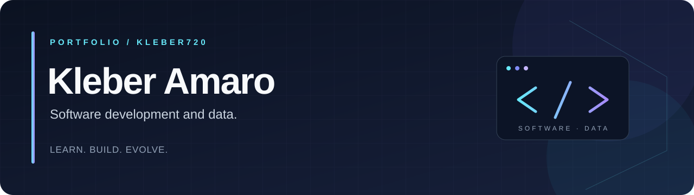

[← Início](https://github.com/Kleber720) · [Desenvolvedor](https://github.com/Kleber720/Kleber720/blob/main/DESENVOLVEDOR.md) · [Dados](https://github.com/Kleber720/Kleber720/blob/main/DADOS.md)

# Desenvolvedor

**Building experiences through code, creativity, and continuous learning.**

[Main projects](#main-projects) · [Technologies](#technologies) · [Skills](#skills-in-practice) · [Studies and tutorials](#studies-and-tutorials)

## About me

I’m **Kleber Amaro**, a **Game Design student at Anhembi Morumbi** and a **graduate of the technical IT program at Senac Santana**. I also participate in **Brasil Games Lab in playtesting**.

My work connects web development, games, and databases. This profile separates my **four main projects** from my **study and tutorial repositories**, which document my learning process.

## Main projects

### 01 · [ProjetoEducacao — EduKation](https://github.com/Kleber720/ProjetoEducacao)

**Web application · React / TypeScript / Node.js / MySQL**

A study platform with Pomodoro and Cornell workspaces, notebook creation, editing and deletion, YouTube video embedding, and user registration. It connects a React frontend to an Express API and a relational database.

### 02 · [MotionVerse](https://github.com/Kleber720/MotionVerse)

**Collaborative game project · JavaScript / MediaPipe / Node.js**

A 2D adventure with gesture controls, hand tracking, and a level editor. Developed collaboratively at Senac Santana; this repository is a fork of the team project.

### 03 · [bancodeDadosCOR — Corinthians Data Analytics](https://github.com/Kleber720/bancodeDadosCOR)

**Database project · SQL / MySQL**

Relational modeling of players and club statistics, referential integrity, and analytical views for goal contributions, goal difference, and points earned.

### 04 · [ProjetoBancodeDados — Corporate Notebook Management](https://github.com/Kleber720/ProjetoBancodeDados)

**Collaborative database project · SQL / MySQL**

A database for managing employees, departments, and corporate notebooks, with stored procedures, transactions, views, and security scripts. Developed as a team project at Senac Santana.

## Technologies

**Languages and web foundations used across projects and learning exercises**

**Tools and libraries used across projects and studies**

## Skills in practice

- **Web interfaces:** HTML and CSS layouts, React components, and JavaScript interactions.
- **Backend and APIs:** Express routes, data validation, DTOs, services, and frontend/backend integration.
- **Databases:** relational modeling, SQL queries, foreign keys, views, and CRUD operations.
- **Games:** JavaScript game logic, characters, levels, animation, and gesture interaction.
- **Python practice:** Flet interfaces, JSON persistence, and layered code organization in study repositories.
- **Collaboration:** team projects, Git/GitHub version control, Game Design studies, and playtesting.

These skills reflect my published projects and ongoing practice. The repositories below are learning material.

## Studies and tutorials

**Every repository in this section is a study exercise, course activity, practice project, or tutorial follow-along. Only the four repositories in “Main projects” are presented as main portfolio projects.**

Their READMEs are currently in Portuguese.

<b>Web development studies and tutorials</b>

- [html](https://github.com/Kleber720/html) — HTML and CSS exercises and challenges.
- [html-CSS-Senac-Santana](https://github.com/Kleber720/html-CSS-Senac-Santana) — web development course activities.
- [projeto-android](https://github.com/Kleber720/projeto-android) — HTML/CSS article-page tutorial.
- [Projeto-cordel](https://github.com/Kleber720/Projeto-cordel) — reading-page exercise with parallax.
- [projeto-redes-sociais](https://github.com/Kleber720/projeto-redes-sociais) — social-page navigation exercise.
- [Site-de-treinamento](https://github.com/Kleber720/Site-de-treinamento) — introductory browser experiments.

<b>Programming studies and practice</b>

- [JavaScript](https://github.com/Kleber720/JavaScript) — logic, functions, Canvas, and browser-game exercises.
- [HeadFirst-JavaScript](https://github.com/Kleber720/HeadFirst-JavaScript) — chapter-based learning exercises.
- [estudosNodeTI102](https://github.com/Kleber720/estudosNodeTI102) — Node.js, APIs, TypeScript, React, and MySQL course practice.
- [SistemaLimpeza](https://github.com/Kleber720/SistemaLimpeza) — Python, Flet, and JSON study application.
- [UpTickets](https://github.com/Kleber720/UpTickets) — collaborative event-management practice; fork of a learning project.

<b>Game and presentation studies</b>

- [Projeto_Jogo_Senac](https://github.com/Kleber720/Projeto_Jogo_Senac) — collaborative 2D game practice.
- [Home](https://github.com/Kleber720/Home) — presentation-website practice related to MotionVerse.

These repositories are study material even when related to a main project. Their READMEs identify the original fork sources.

---

**Web · Games · Data**  
Learning, building, and improving one project at a time.

[Explore all repositories](https://github.com/Kleber720?tab=repositories)

---

[← Início](https://github.com/Kleber720) · [Desenvolvedor](https://github.com/Kleber720/Kleber720/blob/main/DESENVOLVEDOR.md) · [Dados](https://github.com/Kleber720/Kleber720/blob/main/DADOS.md)
