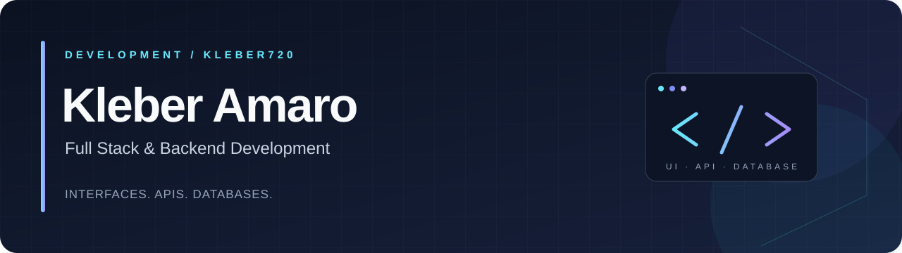

[← Home](https://github.com/Kleber720) · [Development](https://github.com/Kleber720/Kleber720/blob/main/DEVELOPMENT.md) · [Data](https://github.com/Kleber720/Kleber720/blob/main/DATA.md)

# Full Stack & Backend Development

**Connecting React interfaces, TypeScript APIs, and relational databases.**

**Seeking opportunities in Full Stack and Backend Development.**

[Backend skills](#backend-development) · [Full Stack skills](#full-stack-development) · [Projects](#featured-projects) · [Tech stack](#tech-stack) · [Studies](#studies-and-practice)

## About me

I'm **Kleber Amaro**, a graduate of the **technical IT program at Senac Santana** and a **Game Design student at Anhembi Morumbi**. I focus on building applications with **JavaScript, TypeScript, React, Node.js, Express, and MySQL**.

My work connects the user interface to application logic and persistent data. I practice separating responsibilities across controllers, services, and persistence layers, validating input, and writing tests for API behavior. Collaborative projects and playtesting at **Brasil Games Lab** also shape how I think about user experience and teamwork.

## Backend development

- **HTTP APIs:** implement Express routes and controllers for CRUD operations, with JSON responses and appropriate HTTP status codes.
- **Application logic:** validate identifiers and field values, handle missing records, and coordinate operations through services and DTOs.
- **Persistence:** use parameterized MySQL queries, repository interfaces, and a shared connection pool.
- **Data modeling:** define entities, foreign keys, uniqueness constraints, and relationships that support application behavior.
- **Automated checks:** exercise API routes, validation, updates, deletion, and database failure responses with isolated database stubs.

**Start with:** [EduKation's backend](https://github.com/Kleber720/ProjetoEducacao/tree/main/backend).

## Full Stack development

- **React interfaces:** build shared components, forms, navigation, and workspaces for creating and editing content.
- **Frontend/API integration:** connect UI actions to backend endpoints through shared request helpers and feature-specific services.
- **Complete user workflows:** create, reopen, update, and delete saved notebooks with MySQL persistence.
- **Error handling:** surface API errors and handle partial loading failures in the notebook panel.
- **Interactive features:** implement a Pomodoro countdown and shared YouTube URL parsing for study workspaces.

**Start with:** [EduKation's frontend](https://github.com/Kleber720/ProjetoEducacao/tree/main/frontend/src).

## Featured projects

### 01 · [EduKation — Study Platform](https://github.com/Kleber720/ProjetoEducacao)

**Full Stack application · React / JavaScript · TypeScript / Node.js / Express · MySQL**

**Problem:** students need a place to organize study notes, use structured study methods, and return to saved material.

**Implementation:** a React frontend connects to an Express API and MySQL. Users can work with Pomodoro and Cornell notebooks, create and edit notes, reopen saved content, and delete notebooks. The application also includes account registration, credential validation, a timer, and YouTube embedding.

**Engineering highlights**

- Controllers, services, DTOs, repository contracts, and infrastructure classes separate request handling, validation, and persistence.
- Parameterized SQL queries handle notebook creation, listing, updates, and deletion.
- Validation checks identifiers, required titles, field types, and content length before persistence.
- A shared frontend API wrapper handles JSON responses and request errors.
- Automated tests cover API behavior, validation, updates without duplication, deletion, database errors, and frontend service integration using database stubs.

**Delivered:** an integrated local application with database scripts, documented endpoints, setup instructions, and an automated test suite. The repository documents the current development scope and limitations.

[Explore the project](https://github.com/Kleber720/ProjetoEducacao) · [Review service logic](https://github.com/Kleber720/ProjetoEducacao/blob/main/backend/services/PomodoroServices.ts) · [Review SQL persistence](https://github.com/Kleber720/ProjetoEducacao/blob/main/backend/infrastructure/PomodoroInfrastructure.ts) · [Browse tests](https://github.com/Kleber720/ProjetoEducacao/tree/main/backend/tests) · [Inspect frontend integration](https://github.com/Kleber720/ProjetoEducacao/blob/main/frontend/src/services/api.js)

### 02 · [Corporate Notebook Management Database](https://github.com/Kleber720/ProjetoBancodeDados)

**Backend database foundations · SQL / MySQL · Collaborative project**

**Problem:** track corporate notebooks, their assigned employees, departments, and availability.

**Implementation:** a relational model with primary and foreign keys, uniqueness constraints, reporting views, and stored procedures. Assignment and return operations use transactions with COMMIT and ROLLBACK handling.

**Delivered:** database scripts that demonstrate relational modeling, operational queries, and transactional updates for an asset-management scenario.

Developed at Senac Santana by **César de Oliveira Zanelatto, Kleber Amaro da Silva, and Rafael Sper Moralli**. This repository is a fork of [CesarZanelatto/ProjetoBancodeDados](https://github.com/CesarZanelatto/ProjetoBancodeDados).

[Explore the project](https://github.com/Kleber720/ProjetoBancodeDados) · [Review the schema](https://github.com/Kleber720/ProjetoBancodeDados/blob/main/ProjetoDB/Tabelas.sql) · [Review transactions](https://github.com/Kleber720/ProjetoBancodeDados/blob/main/ProjetoDB/Transacoes.sql)

### Additional portfolio projects

- **[MotionVerse](https://github.com/Kleber720/MotionVerse)** — collaborative JavaScript game with MediaPipe gesture interaction and a level editor. Developed at Senac Santana; this repository is a fork of the team project. It demonstrates interactive programming and teamwork.
- **[Corinthians Data Analytics](https://github.com/Kleber720/bancodeDadosCOR)** — relational modeling and analytical SQL views. Explore the [Data portfolio](https://github.com/Kleber720/Kleber720/blob/main/DATA.md) for the case study.

## Tech stack

**Core application stack**

**Web foundations and tooling**

HTTP APIs · CRUD · Input validation · DTOs · Repository interfaces · Parameterized queries · API tests

**Additional programming practice**

## Studies and practice

These repositories are **course activities, exercises, tutorials, or practice projects**. They complement the four portfolio projects listed above.

### Backend and application practice

- [Node.js and API studies](https://github.com/Kleber720/estudosNodeTI102) — Express, TypeScript, React, MySQL, and layered application structure.
- [Inventory Management Practice](https://github.com/Kleber720/SistemaLimpeza) — Python, Flet, JSON persistence, and data-access layers.
- [UpTickets](https://github.com/Kleber720/UpTickets) — collaborative event-management practice with Python, Flet, and JSON; a fork of a learning project.

<b>Web foundations and JavaScript practice</b>

- [HTML and CSS exercises](https://github.com/Kleber720/html) — exercises and layout challenges.
- [Senac web development coursework](https://github.com/Kleber720/html-CSS-Senac-Santana) — HTML and CSS course activities.
- [Android article-page tutorial](https://github.com/Kleber720/projeto-android) — HTML/CSS page construction.
- [Cordel reading-page exercise](https://github.com/Kleber720/Projeto-cordel) — layout and parallax.
- [Social-page navigation exercise](https://github.com/Kleber720/projeto-redes-sociais) — navigation and embedded pages.
- [Introductory website experiments](https://github.com/Kleber720/Site-de-treinamento) — browser fundamentals.
- [JavaScript exercises](https://github.com/Kleber720/JavaScript) — logic, functions, Canvas, and browser games.
- [Head First JavaScript](https://github.com/Kleber720/HeadFirst-JavaScript) — chapter-based exercises.

<b>Game and presentation practice</b>

- [Senac game project](https://github.com/Kleber720/Projeto_Jogo_Senac) — collaborative 2D game practice.
- [MotionVerse presentation website](https://github.com/Kleber720/Home) — presentation-site practice related to the game.

## Career focus

I'm seeking **Full Stack or Backend Development opportunities** where I can contribute to APIs, application features, database integration, and maintainable code.

My repositories provide concrete examples of how I connect interfaces, application logic, and persistence, with implementation details available for technical review.

---

**From user interaction to API logic and persistent data.**

[← Home](https://github.com/Kleber720) · [Development](https://github.com/Kleber720/Kleber720/blob/main/DEVELOPMENT.md) · [Data](https://github.com/Kleber720/Kleber720/blob/main/DATA.md)

